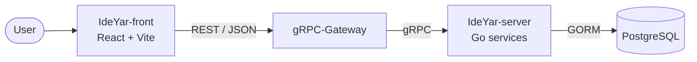

<div align="center">


# IdeYar

**Turn ideas into funded projects.**
A platform where creators share their ideas and the community backs the ones worth building.

[](https://github.com/ideYar/IdeYar-server)
[](https://github.com/ideYar/IdeYar-front)
[](https://github.com/ideYar/IdeYar-front)
[](https://github.com/ideYar/IdeYar-server)
[](#)

</div>

---

## 📦 Repositories

| Repository | Description | Stack | License |
|---|---|---|---|
| [**IdeYar-server**](https://github.com/ideYar/IdeYar-server) | Back-end API | Go · gRPC · gRPC-Gateway · GORM · PostgreSQL · JWT | MIT |
| [**IdeYar-front**](https://github.com/ideYar/IdeYar-front) | Web client | React · TypeScript · Vite · MUI · Redux Toolkit · i18next | GPL-2.0 |

## 🏗️ Architecture



- **API-first:** contracts are defined in Protocol Buffers; gRPC-Gateway exposes them as a REST/JSON API for the web client.
- **Auth:** stateless JWT authentication.
- **Persian-first UI:** full RTL layout and Jalali (Shamsi) calendar support, with i18n built in.
- **Quality:** end-to-end tests on the server, Jest + Testing Library on the client, and CI via GitHub Actions.

## 🚀 Quick start

```bash
# Back end
git clone https://github.com/ideYar/IdeYar-server.git
cd IdeYar-server
docker compose up -d

# Front end
git clone https://github.com/ideYar/IdeYar-front.git
cd IdeYar-front
npm install
npm run dev
```

See each repository's README for configuration details.

## 🤝 Contributing

Issues and pull requests are welcome. Please open an issue to discuss larger changes before starting work.